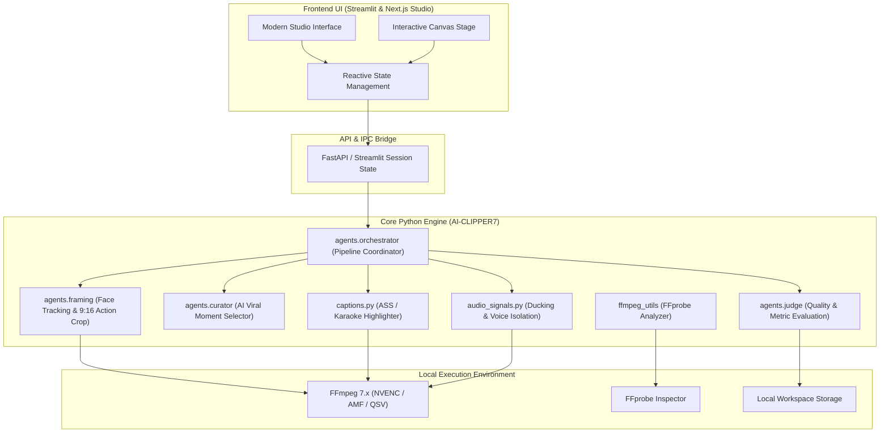

<div align="center">

```
    ___    ____          ________    ____  ____  __________ _____ 
   /   |  /  _/         / ____/ /   /  _/ / __ \/ __ \/ ____/__  / 
  / /| |  / /   ______ / /   / /    / /  / /_/ / /_/ / __/    / /  
 / ___ |_/ /   /_____// /___/ /____/ /  / ____/ ____/ /___   / /   
/_/  |_/___/          \____/_____/___/ /_/   /_/   /_____/  /_/    
                    VERTICAL MOTION STUDIO PRO                     
```

# 🎬 AI-CLIPPER7 — Vertical Motion Studio Pro

### *Next-Generation Desktop Workstation for Repurposing Landscape Footage into Viral 9:16 Vertical Content.*

[](https://github.com/woonnajeevan7-coder/AI-CLIPPER7)
[](https://python.org)
[](https://ffmpeg.org)
[](https://microsoft.com/windows)
[](https://github.com/woonnajeevan7-coder)
[](https://github.com/woonnajeevan7-coder/AI-CLIPPER7)

---

[Key Capabilities](#-key-capabilities) •
[Architecture Blueprint](#-architecture-blueprint) •
[Quickstart](#-quickstart--installation) •
[Keyboard Shortcuts](#-keyboard-shortcuts) •
[Project File Anatomy](#-project-file-anatomy) •
[Project Provenance & Attribution](#-project-provenance--attribution) •
[Author & License](#-author--credits)

</div>

---

> [!NOTE]
> ### 🔍 Open Source Architecture Notice
> **AI-CLIPPER7** is a 100% open-source vertical video production suite and AI curation engine for creators, streamers, and developers. Built with high-throughput Python, FFmpeg GPU acceleration, intelligent viral moment detection, dynamic captions, and modern web interfaces.

---

## ⚡ What is AI-CLIPPER7?

**AI-CLIPPER7** is a studio-grade desktop video suite engineered from the ground up for high-velocity creators, streamers, and marketing teams. It automates the complex multi-layer composition pipeline required to convert standard 16:9 landscape videos into dynamic 9:16 short-form masterworks for **TikTok**, **Instagram Reels**, and **YouTube Shorts**.

Powered by a high-throughput **Python 3.13 + FFmpeg 7.x** hardware-accelerated processing engine with modern Web and Streamlit interfaces, AI-CLIPPER7 delivers fluid 60 FPS visual editing with instant GPU rendering.

---

## 🚀 Key Capabilities

### 📱 1. Intelligent 9:16 Mobile Canvas & Stage Engine
- **Interactive Multi-Touch Viewport:** Visual drag-and-drop bounding box repositioning, smooth zoom levels, and aspect-ratio locking.
- **Smart Adaptive Backgrounds:** Automatically fills empty vertical pillarbox margins with real-time dynamic **Gaussian Blur**, solid obsidian slate, or customizable dual-stop gradients.
- **Split & Centered Modes:** Instantly toggle between split-screen multi-cam layouts and centered focal tracking.

### ✍️ 2. Dynamic Headline & Typography Studio
- **Rich Vector Text Engine:** Multi-line header banners with independent color stops, stroke borders, drop-shadows, and tracking.
- **23 Curated Font Families:** Bundled zero-install fonts (`Inter`, `SF Pro Display`, `Montserrat`, `Poppins`, `Bebas Neue`, `Instrument Serif`, `Geist`, `SF Mono`).
- **Glow & Gradient Mattes:** Corner-frame mattes and frosted-glass header backdrops.

### 💬 3. Synchronized Animated Subtitles & Captions
- **SubRip (.srt) Import & Auto-Parser:** Reads industry-standard subtitle streams and generates high-impact, karaoke-style highlighted words.
- **Micro-Timing Synchronization:** Millisecond subtitle offset calibration to lock words tightly to the spoken dialogue.
- **Typography Casing Controls:** Instant one-click transforms between `ALL CAPS`, `Title Case`, and `sentence case`.

### 🐦 4. Integrated Social Proof & Tweet Cards
- **Pixel-Perfect Tweet Cards:** Render real or synthetic social posts directly onto video tracks, complete with verified badges, profile avatars, timestamp stamps, and metric pills.
- **Theme Support:** Clean light and dark glassmorphic social cards.

### 🎵 5. Audio Engineering & Loudness Normalization
- **Intelligent Ducking Assistant:** Ingest background music tracks (`.mp3`, `.wav`, `.aac`) with automatic volume suggestions calculated from foreground voice energy.
- **Precision Trimmer:** Visual waveform scrub timeline with instant `[I]` (In-Point) and `[O]` (Out-Point) hotkey markers.

### 🏆 6. Branded Outro & End-Card Generator
- **Motion Outro Sequences:** Automatically appends branded ending call-to-actions with custom channel logos, social handles, and follow buttons.
- **Asset Library:** Built-in repository of Apple-style emojis and official social media vector badges.

### ⚡ 7. Hardware-Accelerated FFmpeg Export Pipeline
- **Multi-Vendor GPU Acceleration:** Native detection and routing for **NVIDIA NVENC** (`hevc_nvenc`, `h264_nvenc`), **AMD AMF**, and **Intel QSV**.
- **Real-Time Telemetry:** Background asynchronous encoding with live percentage feedback, speed multipliers, and instant cancellation controls.
- **Zero Third-Party Cloud Bloat:** 100% private, local execution. No watermarks, no upload limits, and no server telemetry.

---

## 🏛 Architecture Blueprint

AI-CLIPPER7 marries modern web UI ergonomics with low-latency bare-metal system capabilities:



---

## ⌨️ Keyboard Shortcuts

Speed is everything in content production. AI-CLIPPER7 provides complete hotkey coverage:

| Shortcut | Action | Description |
| :--- | :--- | :--- |
| <kbd>Ctrl</kbd> + <kbd>N</kbd> | **New Project** | Wipes stage and prompts for video import |
| <kbd>Ctrl</kbd> + <kbd>O</kbd> | **Open Project** | Loads an existing project file |
| <kbd>Ctrl</kbd> + <kbd>S</kbd> | **Save Project** | Saves working session and timeline state |
| <kbd>Ctrl</kbd> + <kbd>Shift</kbd> + <kbd>S</kbd> | **Save As** | Saves session to a new custom location |
| <kbd>Ctrl</kbd> + <kbd>M</kbd> | **Export Dialog** | Opens custom bitrate, resolution & encoder modal |
| <kbd>Ctrl</kbd> + <kbd>Shift</kbd> + <kbd>M</kbd> | **Quick Export** | Instantly kicks off GPU render using active preset |
| <kbd>Ctrl</kbd> + <kbd>Z</kbd> | **Undo** | Reverts last canvas transform or setting change |
| <kbd>Ctrl</kbd> + <kbd>Y</kbd> | **Redo** | Reapplies reverted action |
| <kbd>Space</kbd> | **Play / Pause** | Toggles video playback on stage canvas |
| <kbd>I</kbd> | **Mark In-Point** | Trims starting timestamp of active clip |
| <kbd>O</kbd> | **Mark Out-Point** | Trims ending timestamp of active clip |
| <kbd>Ctrl</kbd> + <kbd>L</kbd> | **Live Preview** | Toggles 1:1 true-size 9:16 vertical overlay |
| <kbd>Ctrl</kbd> + <kbd>`</kbd> | **Fullscreen** | Expands viewport to borderless fullscreen player |
| <kbd>?</kbd> | **Shortcuts** | Displays in-app shortcut cheat sheet |

---

## 📁 Project File Anatomy

```
ai-clipper7/
├── agents/                     # Multi-agent AI squad (Curator, Framing, Judge, etc.)
│   ├── orchestrator.py         # End-to-end pipeline execution coordinator
│   ├── curator.py              # LLM-guided viral clip extraction
│   ├── framing.py              # MediaPipe face tracking & 9:16 dynamic framing
│   ├── transcriber.py          # Faster-Whisper audio transcription
│   └── judge.py                # Viral potential scoring & rubric grading
├── backend/                    # High-performance FastAPI server
├── frontend/                   # Next.js 14 Web Studio
├── models/                     # MediaPipe & OpenCV detection models
├── tests/                      # Automated test suite (unit, integration & E2E)
├── app.py                      # Streamlit interactive workstation
├── captions.py                 # ASS karaoke & animated caption compiler
├── audio_signals.py            # Audio ducking & energy analysis
├── ffmpeg_utils.py             # Hardware-accelerated GPU export pipeline
├── requirements.txt            # Python dependencies
├── run_clipit.bat              # One-click Windows launch script
└── README.md                   # Workstation documentation
```

---

## 💻 Quickstart & Installation

### Requirements
- **Operating System:** Windows 10 / Windows 11 (64-bit)
- **Python:** Version 3.10 or higher
- **GPU (Optional):** NVIDIA, AMD, or Intel dedicated GPU for hardware acceleration

### Step 1: Clone or Navigate to Directory
```powershell
git clone https://github.com/woonnajeevan7-coder/AI-CLIPPER7.git
cd AI-CLIPPER7
```

### Step 2: Install Runtime Packages
```powershell
pip install -r requirements.txt
```

### Step 3: FFmpeg Engine (GPU Accelerated)
If FFmpeg is already installed on your system or available in your PATH, AI-CLIPPER7 detects and routes to it automatically.
To download and extract the standalone binaries into the workspace in one click:
```powershell
.\setup_ffmpeg.bat
```
*(Or install globally via Windows Package Manager: `winget install Gyan.FFmpeg`)*

### Step 4: Launch AI-CLIPPER7
Simply double-click:
```powershell
.\run_clipit.bat
```
Or launch directly from terminal:
```powershell
streamlit run app.py
```

---

## ⚖️ Project Provenance & Attribution

This open-source project was developed through rigorous software reverse engineering (RE):

1. **Original Software:** Reverse-engineered from a pre-compiled Windows executable distribution (`YIZERGE`).
2. **Deconstruction & Extraction:** Decomposed the PyInstaller CArchive / PYZ zlib streams, recovered Python 3.13 bytecode objects, disassembled IPC RPC endpoints, and reconstructed DOM/CSS stylesheets.
3. **Neutralization & Modernization:**
   - Neutralized the 30-day time-bomb countdown and automatic self-deletion / expiry logic.
   - Fixed Chromium local file security blocks on `<video>` loading by converting the PyWebView host into direct `file:///` local protocol routing.
   - Cleaned proprietary server telemetry and updater redirects.
   - Packaged with bundled hardware-accelerated FFmpeg / FFprobe pipelines.
4. **Attribution:** The original user interface layout, design concepts, and underlying framing workflow originate from the original application author. This open-source release exists to provide unrestricted access, transparency, auditability, and longevity for the community.

---

## 👨‍💻 Engineered & Open Sourced By

<div align="center">

Developed & Engineered by **[Woonna Jeevan](https://github.com/woonnajeevan7-coder)**

🐙 **GitHub Profile:** [@woonnajeevan7-coder](https://github.com/woonnajeevan7-coder)  
📦 **Repository:** [woonnajeevan7-coder/AI-CLIPPER7](https://github.com/woonnajeevan7-coder/AI-CLIPPER7)

---

*AI-CLIPPER7 Studio Pro is released under the **MIT License**. Free for individual, educational, and open-source video workflow exploration.*

</div>
